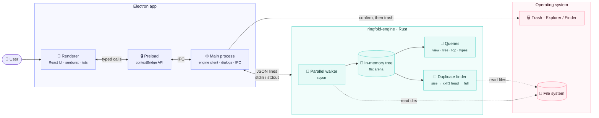

<p align="center">
  
</p>

<h1 align="center">Ringfold</h1>

<p align="center">
  <i>See where your disk space went, ring by ring.</i><br/><br/>
  A fast, good-looking disk space analyzer for Windows, macOS and Linux.<br/>
  See at a glance <b>where</b> your space went and <b>how much</b> each folder takes.
</p>

<p align="center">
  <b>English</b> · <a href="README.ru.md">Русский</a>
</p>

---

## Features

- **Sunburst chart** — rings are nesting levels, slice size is disk usage. Hover to highlight a branch, click to zoom in, click the center to go up.
- **Size list** — every folder's children sorted by size, with bars, share and item counts. Colors match the chart.
- **File types** — space grouped into categories (video, images, archives, code, game data, …) with a per-extension breakdown.
- **Largest files** — the top 200 files anywhere under the current folder.
- **Duplicates** — finds identical files by content (size → quick hash → full hash), shows how much can be freed.
- **Safe actions** — open, show in Explorer/Finder, copy path, move to **trash** (always with a confirmation; nothing is deleted permanently).
- **Fast** — the scanner is a native Rust engine that walks directories in parallel (≈1.9 M files in ~40 s on a regular SSD).
- Russian and English UI, dark and light themes.

## Download

Grab an installer for your platform from the [Releases](../../releases) page:

| Platform | File |
| --- | --- |
| Windows | `Ringfold-x.y.z-setup.exe` or the portable `.exe` |
| macOS (Apple Silicon / Intel) | `Ringfold-x.y.z-mac-arm64.dmg` / `-mac-x64.dmg` |
| Linux | `.AppImage` or `.deb` |

> Builds are not code-signed yet. On macOS, right-click the app → **Open** the first time; on Windows, SmartScreen may ask you to confirm.

## Build from source

Requirements: [Node.js](https://nodejs.org) 22+ and [Rust](https://rustup.rs) (stable).

```bash
git clone https://github.com/Kevin-Haus24/Ringfold.git
cd Ringfold
npm install
npm run dev        # builds the engine and starts the app with hot reload
```

Other scripts:

| Command | What it does |
| --- | --- |
| `npm run build` | Engine + production bundles in `out/` |
| `npm run dist` | Installer for the current OS in `dist/` |
| `npm run typecheck` | TypeScript checks |
| `npm run engine:test` | Rust unit tests |

## How it works



- The engine keeps the scanned tree in memory and answers small queries, so the UI never has to receive millions of entries.
- The renderer is sandboxed with context isolation; deletion goes only through the main process, the system trash and a native confirmation dialog.
- Symlinks and Windows junctions are not followed; hard links are counted once; virtual file systems (`/proc`, `/sys`, …) are skipped when scanning `/`.
- Sizes are logical file sizes (what file managers show), in 1024-based units.

## Project layout

```
engine/            Rust scanner (scan.rs, tree.rs, dupes.rs, protocol.rs)
src/main/          Electron main process: engine client, volumes, IPC
src/preload/       contextBridge API
src/renderer/      React UI (components/, lib/, i18n.tsx, styles.css)
src/shared/        Types and helpers shared by both sides
scripts/           Build helpers
```

## Contributing

Issues and pull requests are welcome — see [CONTRIBUTING.md](CONTRIBUTING.md).

## License

[MIT](LICENSE)
