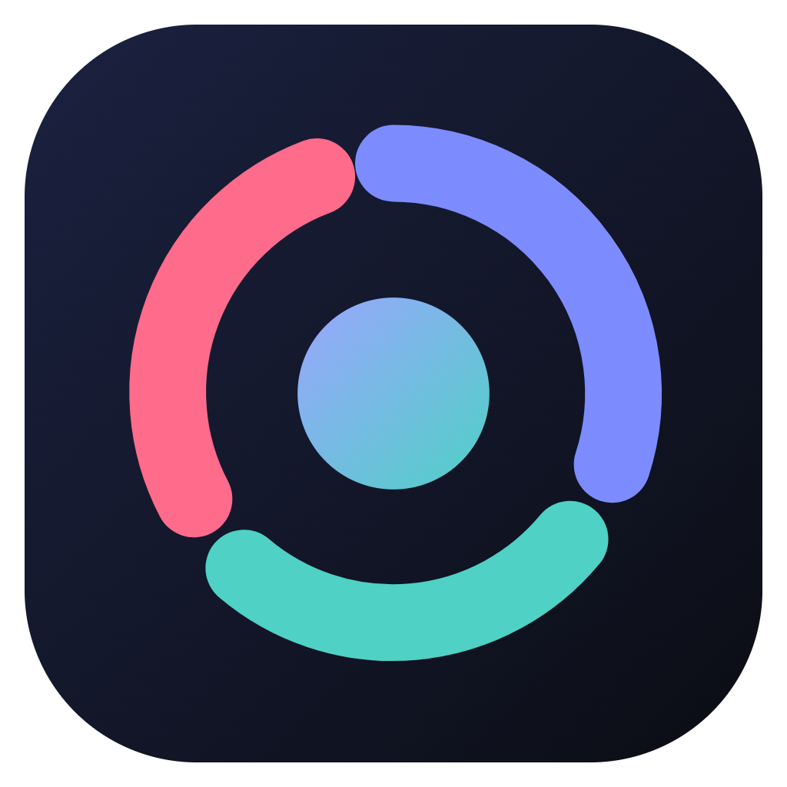
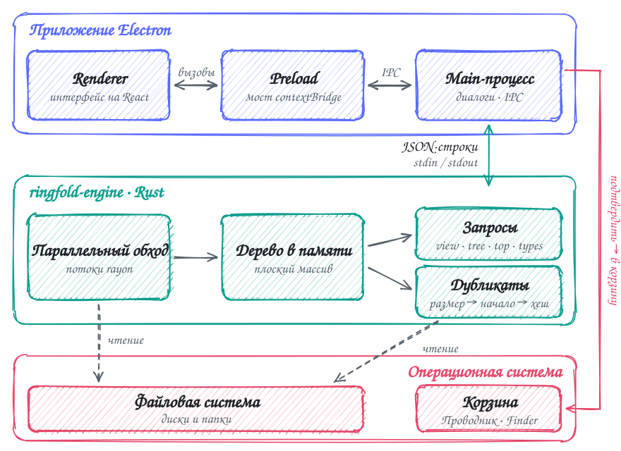

<p align="center">
  
</p>

<h1 align="center">Ringfold</h1>

<p align="center">
  <i>Куда ушло место на диске — кольцо за кольцом.</i><br/><br/>
  Быстрый и красивый анализатор дискового пространства для Windows, macOS и Linux.<br/>
  Сразу видно, <b>где</b> занято место и <b>сколько</b> занимает каждая папка.
</p>

<p align="center">
  <a href="README.md">English</a> · <b>Русский</b>
</p>

---

## Возможности

- **Кольцевая диаграмма** — кольца это уровни вложенности, размер сектора — занятое место. Наведите, чтобы подсветить ветку, кликните, чтобы провалиться внутрь, клик по центру — на уровень выше.
- **Список с полосами** — содержимое папки по убыванию размера: полосы, доля, число объектов. Цвета совпадают с диаграммой.
- **Типы файлов** — место по категориям (видео, изображения, архивы, код, игровые данные…) с разбивкой по расширениям.
- **Крупные файлы** — 200 самых больших файлов в текущей папке и всех вложенных.
- **Дубликаты** — поиск одинаковых файлов по содержимому (размер → быстрый хеш → полный хеш) и подсчёт, сколько можно освободить.
- **Безопасные действия** — открыть, показать в Проводнике/Finder, скопировать путь, переместить в **корзину** (всегда с подтверждением, ничего не удаляется безвозвратно).
- **Скорость** — сканер написан на Rust и обходит папки параллельно (≈1,9 млн файлов примерно за 40 с на обычном SSD).
- Интерфейс на русском и английском, тёмная и светлая темы.

## Скачать

Установщики для каждой платформы — на странице [Releases](../../releases):

| Платформа | Файл |
| --- | --- |
| Windows | `Ringfold-x.y.z-setup.exe` или портативный `.exe` |
| macOS (Apple Silicon / Intel) | `Ringfold-x.y.z-mac-arm64.dmg` / `-mac-x64.dmg` |
| Linux | `.AppImage` или `.deb` |

> Сборки пока не подписаны. На macOS при первом запуске: правый клик по приложению → **Открыть**; в Windows SmartScreen может попросить подтверждение.

## Сборка из исходников

Нужны [Node.js](https://nodejs.org) 22+ и [Rust](https://rustup.rs) (stable).

```bash
git clone https://github.com/Kevin-Haus24/Ringfold.git
cd Ringfold
npm install
npm run dev        # соберёт движок и запустит приложение с горячей перезагрузкой
```

Остальные команды:

| Команда | Что делает |
| --- | --- |
| `npm run build` | Движок + production-сборка в `out/` |
| `npm run dist` | Установщик для текущей ОС в `dist/` |
| `npm run typecheck` | Проверка типов TypeScript |
| `npm run engine:test` | Тесты движка на Rust |

## Как это устроено

<p align="center">
  <picture>
    <source media="(prefers-color-scheme: dark)" srcset="docs/architecture-ru-dark.svg">
    
  </picture>
</p>

- Electron-приложение (React) общается с движком `ringfold-engine` на Rust через stdin/stdout, по одной JSON-строке на сообщение.
- Движок хранит дерево в памяти и отвечает на небольшие запросы, поэтому интерфейс не получает миллионы записей разом.
- Renderer изолирован (sandbox + contextIsolation); удаление идёт только через main-процесс, системную корзину и нативный диалог подтверждения.
- Символические ссылки и junction-точки Windows не обходятся; жёсткие ссылки считаются один раз; при сканировании `/` пропускаются виртуальные ФС (`/proc`, `/sys` и т. п.).
- Размеры — логические размеры файлов (как в файловых менеджерах), единицы по 1024.

## Приватность

Ringfold работает полностью офлайн. Программа не передаёт никакую информацию в другие сетевые системы, если об этом специально не попросит пользователь или тот, кто её устанавливает или запускает. Нет телеметрии, аналитики и проверок обновлений — результаты сканирования остаются на вашем компьютере.

## Участие

Issues и pull request'ы приветствуются — см. [CONTRIBUTING.md](CONTRIBUTING.md).

## Лицензия

[MIT](LICENSE)
